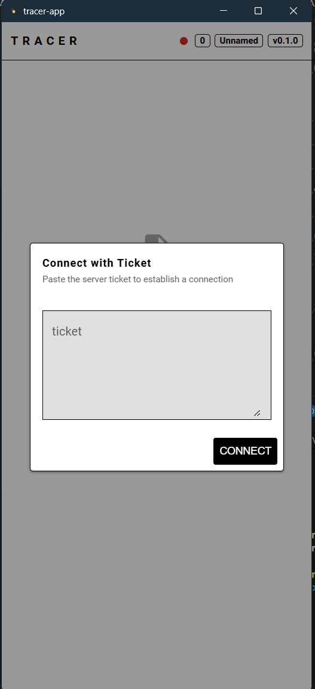

# Tracer Tool

[English](README.md) | [中文](README.zh-CN.md)

A P2P file distribution tool built on [iroh](https://github.com/n0-computer/iroh).
An AI assistant pushes file notices to desktop clients through MCP tools; clients then download the files peer-to-peer (with relay fallback) directly from the server, with live progress reporting.

## How It Works

```
┌─────────────┐   MCP (stdio)   ┌──────────────┐   file_notice (QUIC)   ┌────────────┐
│ AI assistant│ ──────────────▶ │  tracer-mcp  │ ─────────────────────▶ │ tracer-app │
│  (MCP host) │                 │  (server)    │                        │  (client)  │
└─────────────┘                 └──────────────┘ ◀───────────────────── └────────────┘
                                       │            blob download (iroh-blobs, P2P/relay)
```

1. `tracer-mcp` runs as an MCP server over stdio, hosting an iroh endpoint and a blob store.
2. `tracer-app` (a Tauri desktop client) connects to the server with an endpoint ticket and registers a user name.
3. The AI calls the `send_file` tool → the server imports the file into its blob store and pushes a `file_notice` to the target client.
4. The client picks a save location via a native dialog and downloads the blob with real-time progress.

## Screenshots



## Workspace Layout

| Crate | Description |
| --- | --- |
| `tracer-common` | Shared protocol: framed bi-stream messaging, `Payload` message format, path/key resolution |
| `tracer-mcp` | MCP server (stdio, rmcp): connection hub, blob provider, `send_file` / `get_ticker` / `user_all` tools |
| `tracer-app` | Tauri 2 desktop client (Vue 3 + Quasar): ticket connection, notice list, P2P download with progress |

## MCP Tools

| Tool | Description |
| --- | --- |
| `get_ticker` | Get the server connection ticket (endpoint ticket) |
| `user_all` | List all currently registered users |
| `send_file` | Send a file to a specific user (`name`, `file_path`) |

## Quick Start

### Prerequisites

- Rust (stable)
- Node.js + pnpm

### Server (tracer-mcp)

```bash
cargo run -p tracer-mcp
```

CLI options:

```
-d, --data <PATH>    Blobs data directory
                     (fallback: env TRACET_SERVER_DATA_PATH, then cwd/tracer_server_data)
-s, --secret <PATH>  Secret key file
                     (fallback: env TRACET_SERVER_SECRET_KEY, then cwd/tracer_server_secret_key.key)
-h, --help           Print help
```

To use it from an MCP host (e.g. Claude Desktop):

```json
{
  "mcpServers": {
    "tracer": {
      "command": "tracer-mcp"
    }
  }
}
```

> Logs are written to stderr (stdout is reserved for JSON-RPC). Set `RUST_LOG` to control verbosity.

### Client (tracer-app)

```bash
cd tracer-app
pnpm install
pnpm tauri dev      # development
pnpm tauri build    # production bundle
```

On startup the app asks for a **ticket** (get it from the AI via `get_ticker`, or from the server operator), then a **user name**. Once connected, incoming file notices appear in the list — click one, confirm, choose a save location, and the download starts.

## Configuration

| Environment variable | Role | Description |
| --- | --- | --- |
| `TRACET_SERVER_DATA_PATH` | server | Blob store directory |
| `TRACET_SERVER_SECRET_KEY` | server | Secret key file (keep it stable, or the ticket's node id changes) |
| `TRACET_CLIENT_DATA_PATH` | client | Client blob cache directory |
| `RUST_LOG` | both | Log level filter (default `info`) |

## Tech Stack

- **Networking / storage**: iroh 1.4 (QUIC P2P, relay fallback, path migration), iroh-blobs 0.103 (content-addressed blob transfer), iroh-tickets
- **Server**: rmcp (Model Context Protocol, stdio transport), clap
- **Client**: Tauri 2, Vue 3, Quasar, Vite, TypeScript
- **Serialization**: postcard (length-delimited framed messages)
